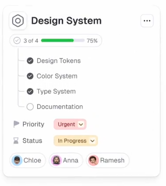

# Propuesta inicial de IA

Respuesta sin revisar al pedido inicial (12/12/2025). Es historial: no es el plan vigente.




## 1. La Filosofía: ¿Cómo se ve este sistema?

Antes de elegir la tecnología, debemos definir la estructura. Para lo que pides (mezcla de tareas, conocimiento, terapia y compras), el estilo que mejor funciona es el de Base de Datos Relacional + Wiki.

No busques una simple "To-Do List". Buscas un OS Personal (Sistema Operativo Personal). Te recomiendo basar la estructura en la metodología PARA de Tiago Forte, que organiza todo en cuatro categorías:

```
P (Proyectos): Cosas con fecha límite (ej: "Desarrollar la App", "Planear viaje").
A (Áreas): Responsabilidades continuas (ej: "Salud/Terapia", "Estudios", "Finanzas").
R (Recursos): Temas de interés y referencias (ej: "Cursos", "Lista de libros", "Notas de programación").
A (Archivos): Cosas terminadas.
```

### Cómo crearla?

Si tu intención es desarrollar el software como un proyecto de programación, esta es la arquitectura que yo diseñaría para ti:

- **Frontend:** **React** o **Next.js**. Necesitas una interfaz reactiva y rápida (SPA). Usa componentes modulares para las "tarjetas" de tareas.
- **Backend:** **Python (FastAPI)**.
- **Base de Datos:** **PostgreSQL** o **Supabase**. ¿Por qué? Porque tus datos son relacionales. Una "Tarea" pertenece a un "Proyecto", y un "Apunte de Terapia" puede vincularse a una "Meta".
- **Alojamiento:** Un contenedor **Docker** en un VPS pequeño (tipo DigitalOcean o Hetzner) o incluso en una Raspberry Pi en tu casa accesible vía Cloudflare Tunnel.
    
    Al estilo microservicios, utilizando buenas practicas de codigo, modularizacion, diseño de la bd y codigo.
    

## Estructura funcional

### El "Dashboard" (Tu Centro de Mando)

Es la página de inicio. No debe tener todo, solo lo inmediato.

- **Widget de Captura Rápida:** Un campo de texto simple para vaciar la mente ("Comprar leche", "Idea para el proyecto X"). Luego se procesa.
- **Calendario Semanal:** Vista de agenda.
- **Tareas de Hoy:** Filtradas por prioridad.

### B. Módulo de "Segundo Cerebro" (Conocimiento)

Aquí van tus listas de **Cursos, Estudios e Ideas**.

- Usa el sistema **Zettelkasten** (fichas).
- **Ejemplo:** Estás estudiando programación. Creas una nota "Curso Python". Dentro, tomas apuntes. Si surge una idea para tu app, creas un enlace a la página de "Ideas de App". Todo está conectado.

### C. Módulo de "Salud Mental & Terapia" (Crucial para ti)

Esta sección debe ser privada y fácil de escribir.

- **Entradas de Diario (Journaling):** Fecha automática.
- **Sistema de Etiquetas (Tags):** Etiquetas como `#Ansiedad`, `#Logro`, `#ParaHablarEnTerapia`.
- **Flujo de trabajo:**
    1. Durante la semana, usas la etiqueta `#ParaTerapia` en cualquier pensamiento que anotes.
    2. Antes de la sesión, filtras por esa etiqueta y tienes tu agenda lista.
    3. Al salir, creas una nota "Resumen Sesión [Fecha]" y extraes de ahí "Tareas" (ej: "Hacer ejercicio de respiración") que van a tu lista de tareas general.

### D. Módulo de Gestión (GTD)

- **Proyectos:** Contenedores de tareas.
- **Listas Simples:** Compras, Películas por ver.

Para integrar un módulo financiero robusto en tu "Segundo Cerebro"

### 1. Ubicación Conceptual (Metodología)

Si seguimos la estructura **PARA** (Proyectos, Áreas, Recursos, Archivos) que mencionamos antes, las Finanzas van en:

**A - ÁREAS (Areas of Responsibility)**

- **Por qué:** Las finanzas no son un proyecto con fecha de fin (no se "terminan"), son una responsabilidad constante que debes mantener saludable indefinidamente.
- **Sub-secciones:** Dentro del Área "Finanzas", tendrías: "Registro Diario", "Presupuestos Mensuales", "Estrategia de Inversión".

**B. La Integración con el "Segundo Cerebro" (Lo que lo hace especial)**
Para que sea integral y no solo un Excel glorificado, debes conectar las finanzas con tus otras listas:

- De "Lista de Compras" a "Gasto":
Cuando marcas un ítem como "Comprado" en tu lista de tareas, tu app debería preguntarte: "¿Cuánto costó?" y crear automáticamente el registro en la tabla Transactions.
- De "Notas de Terapia" a "Finanzas":
Si en terapia hablas de "estrés por deudas", puedes vincular esa nota al dashboard de Goals (Planes de Pago) para ver la relación entre tu salud mental y tu progreso económico.

### 3. El "Dashboard Progresivo" (Frontend)

Mencionaste que quieres ver avances. En tu frontend (React/Next.js), este módulo se visualizaría así:

- **Gráficos de Velas/Barras:** Ingresos vs. Egresos por mes. (Librería recomendada: `Recharts` o `Chart.js`).
- **Barras de Progreso:** Para tus "Planes de Pago" u "Objetivos de Ahorro".
    - *Visual:* Una barra que se llena del 0% al 100% a medida que asignas dinero a esa meta.
- **Calendario de Pagos:**
    - Una vista de calendario donde ves los vencimientos futuros (Internet, Alquiler) para que no te olviden.

### Resumen de dónde ponerlo:

1. **En el menú de navegación:** Crea una sección principal llamada **"Finanzas"** o **"Billetera"**.
2. **En la Base de Datos:** Crea tablas relacionales estrictas (no JSON suelto).
3. **En el Dashboard Principal:** Agrega un pequeño widget que diga "Gastado este mes: $X" y "Ahorro para viaje: 45%".

una visualización de gestión del tiempo conocida como **"Time Blocking Circular"** o **"Time Pie Chart"** (Gráfico Circular de Tiempo), pero con un diseño más minimalista y estético (como un anillo o un *donut chart*).

Este tipo de visualización es ideal para tu "Segundo Cerebro" porque ofrece una visión **holística y rápida** del día, complementando la lista de tareas con el contexto temporal.

Aquí tienes cómo se llama esta funcionalidad, dónde encajaría y la arquitectura técnica para implementarla:

### 1. La Funcionalidad: El "Reloj de Anillo de Tiempo"

Esta característica se conoce como **"Time Blocking Visualizer"** o **"Agenda Circular"**.

- **Diseño:** Un anillo de 24 segmentos (24 horas) o 96 segmentos (bloques de 15 minutos).
- **Interactividad:** Al hacer clic o arrastrar en el anillo, defines un bloque de tiempo (ej: 08:00 a 10:00).
- **Visual:** Cada actividad definida (Trabajo, Estudio, Terapia, Ocio) se renderiza con un color y un emoji (como solicitaste).
    - **Ejemplo:** `09:00 - 13:00` → **Trabajo** (Color Azul, 💻).

### 2. Ubicación Conceptual y Técnica

Esta funcionalidad pertenece al corazón de tu sistema:

- **Ubicación Conceptual (Área):** Pertenece al Área de **"Productividad/Gestión del Tiempo"**. Debe estar visible en el **Dashboard** principal, ya que es la vista del día actual.
- **Ubicación en el Backend (Base de Datos):** Necesitas una tabla dedicada, pero muy simple, que se relacione con tus actividades generales.
    
    Necesitas que la visualización circular (el anillo de tiempo) no sea solo una herramienta de diseño, sino que también actúe como un calendario y planificador diario.
    

La funcionalidad que describes se llama "Daily Agenda View" o "Time Block List View".

1. Integración de Vistas: Anillo y Lista

Tu módulo de gestión del tiempo tendrá un control de "Vista" (Toggle View) que permite cambiar entre:

```
Vista 1: Anillo de Tiempo (Visual): Ideal para la visión global y la distribución del día.

Vista 2: Lista de Agenda (To-Do/Detalle): Ideal para la organización, la edición y la vinculación con tareas.
#### Elementos Clave que esta Vista te Permite Administrar:
```

- **Edición Rápida:** Puedes arrastrar y soltar los bloques de tiempo en la lista, y el Anillo se actualiza automáticamente (y viceversa).
- **Vínculos (Linking):** Esto es crucial para tu "Segundo Cerebro". Cada bloque de tiempo debería tener un campo para vincularse directamente a una **Nota**, un **Proyecto** o un **Elemento de la Lista de Tareas**.
    - *Ejemplo:* El bloque de "Estudio Python" (14:00) te permite hacer clic y saltar directamente a la página de apuntes de ese curso.
- **Checkmarks (Opcional):** Si quieres, puedes tener un pequeño *checkbox* para marcar el bloque como "Completado" al final del día.

    
    Esta funcionalidad es esencial para tu **Módulo de Proyectos (P - Proyectos)** en el sistema PARA.
    

Aquí tienes la arquitectura para crear tu propio **"Project Progress Card"** (Tarjeta de Progreso de Proyecto):

---

### 1. Funcionalidad: Tarjeta de Progreso Minimalista

El objetivo es que con un vistazo sepas: **¿Qué es esto?** (Título), **¿Dónde está?** (Status y Prioridad), y **¿Cuánto falta?** (Barra de Progreso).

### Componentes Clave de la Tarjeta:

1. **Icono y Título:** Identidad del proyecto (ej: ⚙️ Design System).
2. **Barra de Progreso:** Muestra el porcentaje de finalización (ej: 75%).
3. **Sub-Tareas / Check List:** La jerarquía de tareas que componen el proyecto principal.
4. **Metadatos:** Prioridad, Estado y (en tu caso) la persona responsable (aunque sea solo tú).
    
    ### 4. Implementación Frontend (Next.js/React)
    

El componente (la tarjeta) se construiría con:

1. **Iconos:** Para la prioridad (🚩) y el estado (⏳).
2. **Etiquetas (Tags):** Componentes para `Urgent` y `In Progress` (con colores de fondo basados en el estado).
3. **Barra de Progreso (Progress Bar):** Un componente que recibe el `Porcentaje` calculado y lo renderiza visualmente.

Este diseño te permite tener docenas de proyectos grandes, todos visibles en un Dashboard de proyectos, donde puedes escanear rápidamente qué requiere atención sin tener que abrir cada uno.

---

---

## Personal OS Implementation Plan

## Goal Description

Build a "Personal Operating System" based on the PARA methodology (Projects, Areas, Resources, Archives). It functions as a second brain, combining task management, knowledge management (Zettelkasten), mental health tracking (Journaling), and personal finance. The system aims for a high-quality, aesthetic, and responsive interface inspired by "Time Blocking" and "Project Cards".

## User Review Required

IMPORTANT

**Tech Stack Confirmation**:

- Frontend: Next.js (React) + **Tailwind CSS** + **Framer Motion** (for animations).
- Backend: Python (FastAPI) - **Microservices Architecture** with API Gateway.
- Database: PostgreSQL (per service or shared schema depending on complexity, likely shared for MVP but logically separated).
- Styling: **Tailwind CSS** for rapid, consistent, and premium styling.

## Proposed Changes

### Structure

The project will be a monorepo containing:

- `backend/`: Contains all microservices and the gateway.
    - `gateway/`: API Gateway (FastAPI)
    - `services/`:
        - `core/`: Projects, Areas, Tasks (PARA)
        - `finance/`: Transactions, Goals
        - `journal/`: Notes, Zettelkasten, Therapy
- `frontend/`: Next.js application
- `docker-compose.yml`: Orchestration for all services.

### Backend (FastAPI Microservices)

### [NEW] `backend/gateway/`

The API Gateway that routes requests to appropriate services.

- `main.py`: Entry point using `httpx` to proxy requests.

### [NEW] `backend/services/core/`

Handles PARA (Projects, Areas, Resources, Archives) and Tasks.

- `models/`: Database models for Project, Area, Task.
- `main.py`: Service entry point.

### [NEW] `backend/services/finance/`

Handles all financial logic.

- `models/`: Transaction, Goal models.

### [NEW] `backend/services/journal/`

Handles Notes, Zettelkasten, and Therapy sessions.

- `models/`: Note, JournalEntry models.

### Frontend (Next.js + Tailwind)

### [NEW] `frontend/`

Initialized using `npx create-next-app@latest` with **Tailwind CSS**.

### [NEW] `frontend/tailwind.config.ts`

Configuration to include custom "Premium" color palettes and extended themes.

### [NEW] `frontend/components/`

- `TimeBlockingRing.tsx`: Circular daily planner.
- `ProjectCard.tsx`: Minimalist progress card.
- `FinanceWidget.tsx`: Graphs and summaries.

## Verification Plan

### Automated Tests

- Backend: `pytest` for API endpoints.
- Frontend: Manual verification via browser.

### Manual Verification

- Verify the "Time Blocking Ring" interactivity.
- Verify the linkage between "Therapy Notes" and "Tasks".
- Check the responsiveness of the "Project Dashboard".

---

---

## How to Run "Personal OS"

## Prerequisites

- **Docker Desktop** installed and running.
- **Node.js** (v18+) installed.

## 1. Start the Backend (Microservices)

The backend consists of 4 services (Gateway, Core, Finance, Journal) and a PostgreSQL database.

1. Open a terminal in the project root (`c:\\Users\\Madev\\src\\list-master`).
2. Run the following command:
    
    docker-compose up -d --build
    
    *This downloads the images and starts the services in the background.*
    
3. Verify they are running:
    - **Gateway**: [http://localhost:8000](http://localhost:8000/) (Should say "Professional OS API Gateway")
    - **Core**: [http://localhost:8000/api/core](http://localhost:8000/api/core) (Proxied)
    - **Finance**: [http://localhost:8000/api/finance](http://localhost:8000/api/finance) (Proxied)

## 2. Start the Frontend (Dashboard)

1. Open a new terminal.
2. Navigate to the frontend folder:
    
    cd frontend
    
3. Start the development server:
    
    npm run dev
    
4. Open your browser at [http://localhost:3000](http://localhost:3000/).

## 3. What to Test?

### Dashboard UI

- Check the **Sidebar** navigation.
- See the **Premium Dark Mode** aesthetics (try toggling system theme if implemented, currently default dark).
- Interact with the **Quick Capture** input (visual only for now).
- View the **Finance Widget** and **Tasks** placeholder.

### Backend API

You can test the API directly via Swagger UI if you enable it, or simply curl the endpoints.

- Create a Task (via Postman/Curl): `POST <http://localhost:8000/api/core/tasks/`>

